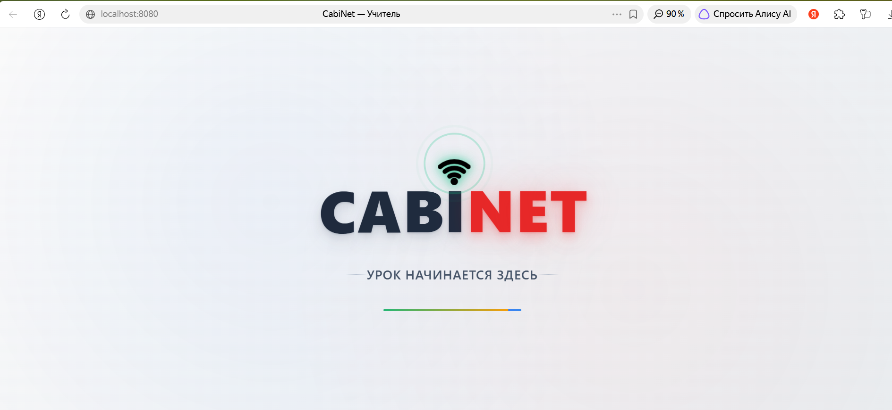
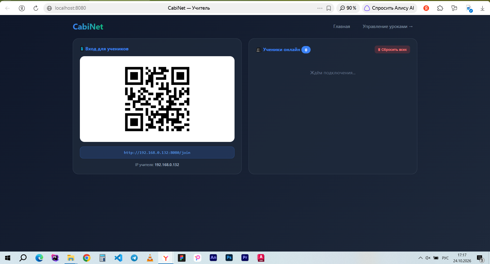
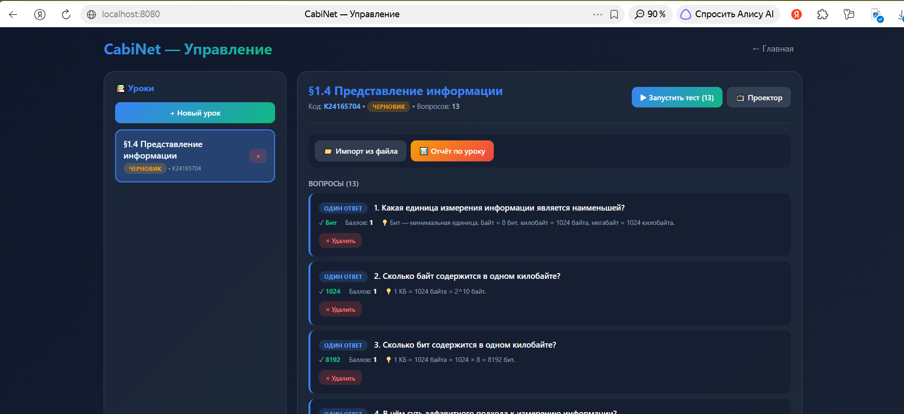

# 🎓 CabiNet — школьная платформа для тестов

> **CabiNet** — платформа для тестов в классе **без интернета**. Учитель запускает программу на ноутбуке, ученики подключаются через Wi-Fi, и урок превращается в интерактив.

---

## ✨ Возможности

- 🔌 **Работает без интернета** — только локальная сеть
- 🎯 **4 типа вопросов**: один ответ, несколько, развёрнутый, опрос
- 🔀 **Персональный порядок** вопросов у каждого ученика
- ⚡ **Мгновенные ответы** в реальном времени
- 📁 **Импорт заданий** из текстового файла

---

## 🚀 Как это работает

1. Учитель запускает CabiNet → видит QR-код
2. Ученики сканируют QR со своих телефонов
3. Вводят имя → попадают на урок
4. Учитель нажимает **«▶ Запустить тест»**
5. Ученики отвечают → учитель видит ответы в реальном времени

---

## 🛠 Технологии

- 🐍 Python 3.10+
- 🌶 Flask + Flask-SocketIO
- 💾 SQLite
- 🎨 HTML5 + CSS3 + JavaScript

---
## Скриншотики

---

## 👨‍💻 Автор

**Новиков Алексей Валерьевич**
Учитель информатики

## 📄 Лицензия

**© 2026 Новиков Алексей Валерьевич. Все права защищены.**

Этот проект является интеллектуальной собственностью автора.
Копирование, распространение и коммерческое использование
без письменного разрешения автора **запрещено**.

Полная версия с расширенными функциями (отчёты, проектор, PDF)
доступна по запросу.

---

## ⭐ Если проект полезен

Поставь звезду 🌟 — это помогает другим учителям узнать о проекте.
